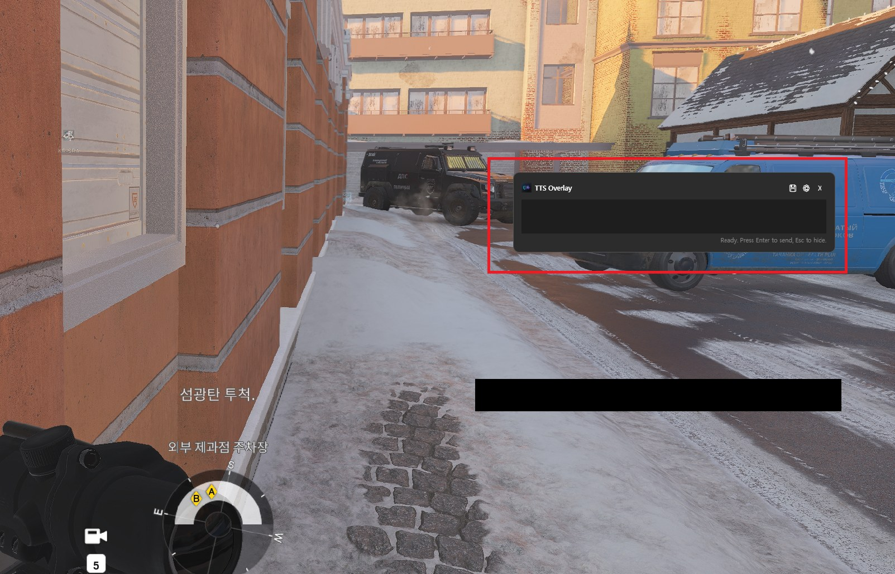
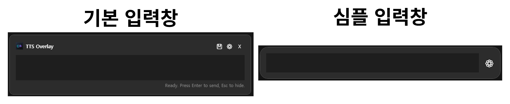
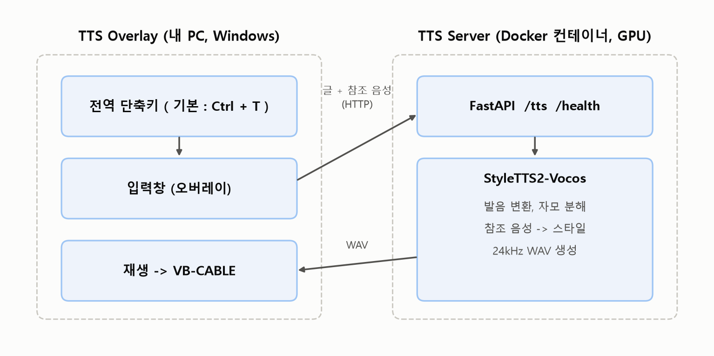
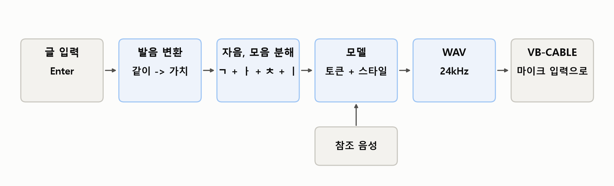
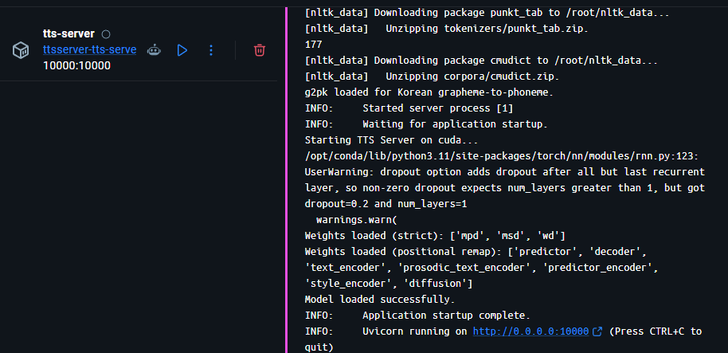
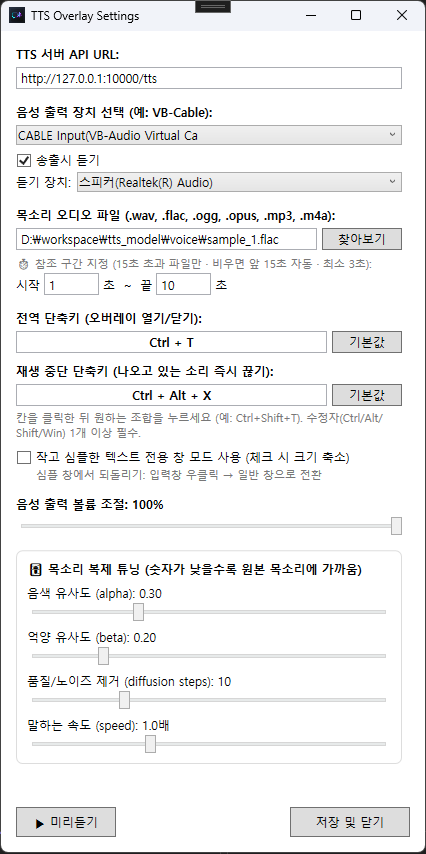
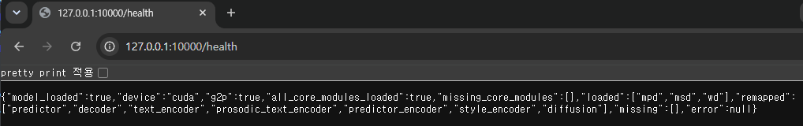
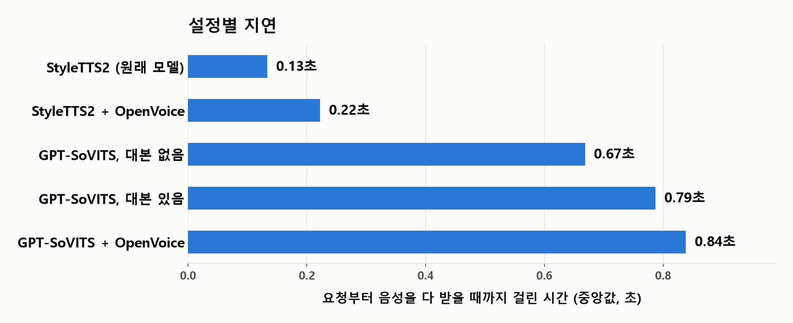
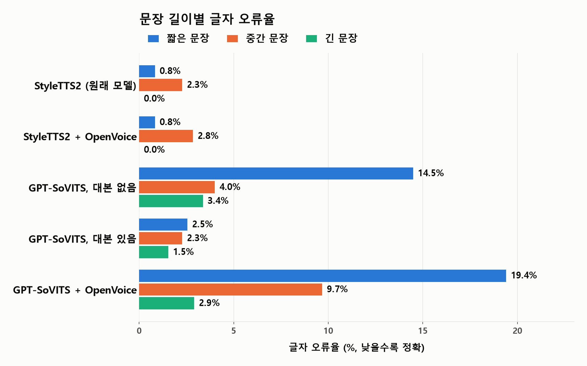

# TTS Overlay

[](./LICENSE)
[](https://www.python.org/)
[](https://pytorch.org/)
[](https://developer.nvidia.com/cuda-toolkit)
[](https://dotnet.microsoft.com/)
[](https://docs.docker.com/compose/)

마이크를 사용할 수 없는 상황에서, 마우스와 내 눈이 화면을 이탈하지 않고 말하기 위해 만든 TTS 프로그램이다.

단축키를 누르고 텍스트를 입력하면 내 PC에서 음성이 만들어지고, VB-Cable 같은 가상 오디오 케이블을 통해 마이크 입력으로 들어간다. 디스코드든 게임 보이스든 마이크를 선택할 수 있는 프로그램이면 어디서든 사용할 수 있다.

```
단축키(Ctrl+T) -> 입력창 -> 글 입력 -> Enter -> 음성 출력
```

| 항목 | 값 (RTX 5070 12GB 기준) |
|---|---|
| 짧은 문장 합성 시간 | 0.11초 |
| 긴 문장(60\~70자, 음성 12초 분량) 합성 시간 | 0.15초 |
| 서버를 가동한 뒤 첫 요청 | 약 9초 |
| GPU 메모리 | 약 1.4GB |

제작 과정과 트러블슈팅 기록은 Velog에 정리했다.

- [[TTS Overlay 제작기] 0.13초 만에 말한다, 그 전에 문제가 13번 있었다 - 1편](https://velog.io/@kyeong9743/TTS-Overlay-1)
- [[TTS Overlay 제작기] 합성 360개를 측정하고, 연결한 모델 두 개를 다시 되돌렸다 - 2편](https://velog.io/@kyeong9743/TTS-Overlay-2)

## 먼저 알아 둘 것

참조 음성 3\~15초를 넣으면 그 목소리의 톤과 분위기를 따라간다. 하지만, **같은 사람으로 들리는 수준은 아니다.** 비슷한 톤의 다른 사람에 가깝고, 쉰 듯한 기계음이 섞인다.

이 문제를 해결해 보려고 GPT-SoVITS와 OpenVoice v2를 연결해서 합성 360개를 측정했지만, 10초짜리 참조 음성으로는 어느 방식도 뚜렷하게 낫지 않아서 다시 되돌렸다. 과정은 [Velog 2편](https://velog.io/@kyeong9743/TTS-Overlay-2)에, 측정 결과는 [docs/MODEL_ANALYSIS.md](docs/MODEL_ANALYSIS.md)에 있다.





---

## 목차

1. [구조](#1-구조)
2. [동작 과정](#2-동작-과정)
3. [사용한 모델](#3-사용한-모델)
4. [사양](#4-사양)
5. [설치와 실행](#5-설치와-실행)
6. [설정](#6-설정)
7. [API](#7-api)
8. [다른 기기에서 접속하기](#8-다른-기기에서-접속하기)
9. [문제 해결](#9-문제-해결)
10. [한계](#10-한계)
11. [폴더 구조](#11-폴더-구조)
12. [문서](#12-문서)
13. [라이선스와 음성 복제 고지](#13-라이선스와-음성-복제-고지)

---

## 1. 구조

| 구성 요소 | 폴더 | 스택 | 하는 일 |
|---|---|---|---|
| TTS Server | `TTS_Server/` | Python, FastAPI, PyTorch, Docker | GPU에서 TTS 모델을 가동하고 음성을 만든다 |
| TTS Overlay | `TTS_Overlay/` | C#, WPF, .NET 8 | 단축키로 입력창을 띄우고, 받은 음성을 재생한다 |

둘은 HTTP로 대화한다. TTS Overlay가 텍스트와 참조 음성을 보내면 TTS Server는 WAV 파일을 반환한다.



### TTS Overlay가 하는 일

- **전역 단축키**: 어느 프로그램 위에서든 입력창을 열고 닫는다. 윈도우가 제공하는 `RegisterHotKey`를 사용하며, 설정에서 조합을 바꿀 수 있다. 다른 프로그램이 사용 중인 조합이면 누르는 즉시 알려 주고, 등록에 실패하면 이전 조합으로 되돌린다
- **입력창**: 항상 위에 표시된다. `Enter`로 전송하고 `Esc`로 숨긴다. 한 줄짜리로 줄이는 심플 창 설정이 있다
- **재생**: 받은 WAV를 지정한 출력 장치로 재생한다. 볼륨은 장치가 아니라 소리 데이터에 직접 적용하므로 가상 장치에서도 작동한다
- **송출시 듣기**: 가상 케이블로 내보내는 소리를 내 스피커나 헤드셋으로도 동시에 들려준다
- **재생 중단 단축키**: 나오고 있는 소리를 즉시 끊는다 (기본 `Ctrl+Alt+X`)
- **미리듣기**: 설정 창에서 현재 값으로 합성해서 듣기 장치로만 재생한다. 출력 장치로는 나가지 않는다

마우스 버튼은 단축키로 지원하지 않는다. 이유는 [Velog 1편](https://velog.io/@kyeong9743/TTS-Overlay-1)에 적었다.

### TTS Server가 하는 일

- **모델 준비**: 컨테이너를 가동하면 Hugging Face에서 체크포인트(약 2.48GB)를 내려받는다. 이미 있으면 건너뛴다
- **한국어 처리**: g2pk로 발음을 변환하고(예: `같이` -> `가치`), 자음과 모음으로 분해해서 토큰으로 바꾼다
- **참조 음성 처리**: 업로드된 음성에서 스타일 벡터를 뽑는다. 같은 파일은 내용 해시로 기억해 두고 다시 계산하지 않는다
- **합성**: 24kHz, 16bit, mono WAV를 만들어 반환한다
- **상태 확인**: `/health`로 모델이 제대로 읽혔는지 확인할 수 있다

---

## 2. 동작 과정

```
[TTS Overlay]
참조 음성 파일을 읽는다 -> 텍스트와 함께 서버로 보낸다

[TTS Server]
텍스트 -> 발음 변환(g2pk) -> 자음, 모음 분해 -> 토큰
참조 음성 -> 스타일 벡터
토큰 + 스타일 벡터 -> 모델 -> 24kHz WAV

[TTS Overlay]
WAV를 받는다 -> 지정한 출력 장치로 재생한다
```



출력 장치를 VB-Cable로 지정하고, 디스코드나 게임에서 마이크를 `CABLE Output`으로 선택하면 TTS가 낸 소리가 내가 말한 것처럼 들어간다.

참조 음성을 경로가 아니라 파일 내용으로 보내는 이유는, 서버가 Docker 컨테이너 안에 있어서 내 PC의 폴더를 볼 수 없기 때문이다.

---

## 3. 사용한 모델

[StyleTTS2-Vocos](https://github.com/5Hyeons/StyleTTS2-Vocos)의 다국어 체크포인트(`AIHUB_ML / epoch_2nd_00006.pth`)를 사용한다. 선택 기준은 음성이 나오는 속도와 가벼움이었다.

- [yl4579/StyleTTS2 (원본)](https://github.com/yl4579/StyleTTS2)
- [5Hyeons/StyleTTS2-Vocos](https://github.com/5Hyeons/StyleTTS2-Vocos)
- [체크포인트 폴더 / huggingface](https://huggingface.co/5Hyeons/StyleTTS2/tree/main/Vocos/AIHUB_ML)
- [StyleTTS 2 논문 / arXiv](https://arxiv.org/abs/2306.07691)

| 항목 | 값 |
|---|---|
| 샘플레이트 | 24,000 Hz |
| 토큰 수 | 498 (다국어 음소, 한글 자음/모음 포함) |
| 스타일 벡터 | 256개 (음색 128 + 운율 128) |
| 디코더 | Vocos |
| 추론에 사용하는 파라미터 | 약 1억 8천만 개 |
| 체크포인트의 학습 단계 | 2단계 8에폭 중 6에폭 |

이 Fork가 원본과 다른 점은 두 가지다. 소리를 만드는 디코더를 HiFi-GAN에서 Vocos로 바꿔서 빠르고, PL-BERT를 제거해서 한국어를 지원한다.

합성 방식은 참조 음성에서 뽑은 스타일과 모델이 예측한 스타일을 섞는 것이다.

```
음색 = alpha * (모델 예측) + (1 - alpha) * (참조 음성)
운율 = beta  * (모델 예측) + (1 - beta)  * (참조 음성)
```

`alpha`와 `beta`가 낮을수록 참조 음성을 더 따라간다.

---

## 4. 사양

### 테스트한 환경

| 항목 | 사양 |
|---|---|
| CPU | AMD Ryzen 9 9950X3D |
| RAM | DDR5 32GB |
| GPU | NVIDIA GeForce RTX 5070 12GB |
| OS | Windows 11 Pro |
| 실행 환경 | Docker Desktop + NVIDIA Container Toolkit, PyTorch 2.7, CUDA 12.8 |

RTX 50 시리즈는 CUDA 12.8 이상과 PyTorch 2.7 이상이 필요하다. 이전 조합(CUDA 11.8, PyTorch 2.1)에서는 동작하지 않는다. 이 저장소의 Dockerfile은 `pytorch/pytorch:2.7.0-cuda12.8-cudnn9-runtime`을 사용한다.

### 필요한 것

| 항목 | 내용 |
|---|---|
| GPU | NVIDIA GPU. 실제 사용량은 약 1.4GB |
| 서버 | Docker, NVIDIA Container Toolkit |
| 클라이언트 | Windows 10/11, .NET 8 Desktop Runtime |
| 가상 오디오 케이블 | [VB-Cable](https://vb-audio.com/Cable/) 등 |

GPU가 없으면 CPU로도 동작하지만 훨씬 느리다. 이 저장소에서 측정한 환경은 위의 RTX 5070 한 가지뿐이다.

---

## 5. 설치와 실행

### 서버

```bash
cd TTS_Server

# 처음 한 번, 또는 Dockerfile이나 requirements.txt를 고쳤을 때
docker compose build

# 실행. 처음에는 모델(약 2.48GB)을 내려받는다
docker compose up
```

- 상태 확인: 브라우저에서 `http://localhost:10000/health`

  

- 서버는 **이 PC에서만 접속된다.** `docker-compose.yml`의 포트가 `127.0.0.1:10000:10000`으로 설정되어 있다. 다른 기기에서 사용하려면 [8번](#8-다른-기기에서-접속하기)을 볼 것
- 모델은 처음 한 번만 내려받는다. 이후에는 `Model already present ... skipping download.`가 출력된다

무엇을 고쳤는지에 따라 필요한 작업이 다르다.

| 고친 것 | 필요한 작업 |
|---|---|
| `server.py`, `download_model.py` | `docker compose restart` |
| `docker-compose.yml` | `docker compose up --force-recreate` |
| `Dockerfile`, `requirements.txt` | `docker compose build` |
| `TTS_Overlay/` | Visual Studio에서 다시 빌드 |

`docker-compose.yml`을 고친 뒤 `restart`만 하면 반영되지 않는다. 컨테이너를 다시 만들어야 한다.

### 클라이언트

1. [VB-Cable](https://vb-audio.com/Cable/)을 설치한다
2. Visual Studio에서 `TTS_Overlay/TtsOverlay.csproj`를 열어 빌드하고 실행한다 (`dotnet run`도 가능)
3. 입력창의 설정 버튼을 눌러 [설정](#6-설정)을 한다
4. 디스코드나 게임에서 마이크(입력 장치)를 `CABLE Output`으로 선택한다

빌드할 때 `TtsOverlay.exe가 사용 중`이라는 오류가 나오면 이전 프로그램이 숨겨진 채 실행 중인 것이다. `Esc`와 단축키는 창을 숨기기만 한다. 입력창의 X 버튼으로 종료하거나 `Stop-Process -Name TtsOverlay -Force`를 실행한 뒤 다시 빌드한다.

### 목소리 파일

참조 음성은 저장소에 포함되어 있지 않다. 사용할 파일을 직접 준비해야 한다.

- 형식: `.wav`, `.flac`, `.ogg`, `.opus`, `.mp3`, `.m4a`
- 길이: 3초 이상. 15초를 넘으면 앞 15초만 사용하거나 설정에서 구간을 지정한다
- 조용한 곳에서 한 사람이 일정한 톤으로 말하는 5\~15초가 가장 좋다

방법은 두 가지다.

- 저장소의 [`voice/`](voice/README.md) 폴더에 `voice.opus`라는 이름으로 넣고 빌드한다. 빌드할 때 실행 폴더로 복사되며, 별도 설정 없이 기본 목소리로 사용된다
- 설정의 "찾아보기"로 PC의 아무 위치에 있는 파일을 지정한다

프로그램 폴더 안의 파일은 상대 경로로 저장되므로, 폴더를 통째로 옮겨도 그대로 동작한다.

---

## 6. 설정



| 항목 | 설명 |
|---|---|
| TTS 서버 API URL | 기본 `http://127.0.0.1:10000/tts` |
| 음성 출력 장치 | 소리를 내보낼 장치. VB-Cable을 선택한다 |
| 송출시 듣기 | 체크하면 출력 장치로 내보내는 소리를 듣기 장치로도 동시에 재생한다 |
| 듣기 장치 | 내가 듣는 스피커나 헤드셋. 미리듣기도 이 장치로 재생된다 |
| 목소리 오디오 파일 | 참조 음성 파일과 사용할 구간(초) |
| 전역 단축키 | 입력창 열기/닫기. 기본 `Ctrl+T` |
| 재생 중단 단축키 | 기본 `Ctrl+Alt+X` |
| 심플 창 | 입력창을 한 줄짜리로 줄인다. 되돌리려면 입력창을 우클릭해서 "일반 창으로 전환"을 선택한다 |
| 볼륨 | 0\~100% |

단축키는 칸을 클릭한 뒤 원하는 조합을 누르면 된다. Ctrl, Alt, Shift, Win 중 1개 이상을 포함해야 한다.

### 목소리 튜닝

| 설정 | 범위 | 낮을 때 | 높을 때 | 기본 |
|---|---|---|---|---|
| 음색 유사도 (alpha) | 0\~1 | 참조 음색에 가깝다 | 모델의 표현이 늘어난다 | 0.1 |
| 억양 유사도 (beta) | 0\~1 | 참조 억양에 가깝다 | 억양이 다양해진다 | 0.5 |
| 다듬는 횟수 (diffusion steps) | 3\~30 | 빠르다 | 조금 더 다듬어진다 | 10 |
| 말하는 속도 (speed) | 0.5\~2.0 | 느리다 | 빠르다 | 1.0 |

측정해 보니 소리의 맑은 정도에 영향이 큰 것은 속도와 참조 음성이었다. 속도를 1.4배로 올리면 소리가 눈에 띄게 거칠어지고, 합성 결과는 참조 음성의 맑은 정도를 거의 그대로 따라간다. alpha, beta, 다듬는 횟수는 영향이 작았다.

표현력 강도(`embedding_scale`)는 1.0으로 고정되어 있다. 이 체크포인트는 1.0이 아니면 스타일을 만드는 계산이 무작위로 발산해서 긴 잡음이 나온다. 1.1에서도 60번 중 22번이 잡음이었다.

---

## 7. API

### `POST /tts`

```jsonc
{
  "text": "합성할 텍스트",            // 필수. 2,000자 이하
  "speaker_wav_b64": "<base64>",     // 참조 음성 파일 전체를 base64로
  "alpha": 0.1,                      // 0~1
  "beta": 0.5,                       // 0~1
  "diffusion_steps": 10,             // 1~100
  "embedding_scale": 1.0,            // 1.0 권장. 다른 값은 서버가 발산을 검사해서 다시 만들거나 1.0으로 대체한다
  "speed": 1.0,                      // 0.1~4.0
  "ref_start": null,                 // 참조 음성에서 사용할 구간 시작(초)
  "ref_end": null                    // 참조 음성에서 사용할 구간 끝(초)
}
```

| 응답 | 내용 |
|---|---|
| 200 | `audio/wav`. 24kHz, 16bit, mono |
| 400 | 참조 음성이 없거나 3초 미만, 구간 오류, 형식 인식 실패. `{"detail": "..."}` |
| 422 | 값이 범위를 벗어남 |
| 500 | 모델을 읽지 못했거나 합성 중 오류 |

참조 음성 규칙은 다음과 같다.

| 조건 | 서버 동작 |
|---|---|
| 3초 미만 | 거부 (400) |
| 3\~15초 | 전체 사용 |
| 15초 초과, 구간 미지정 | 앞 15초 사용 |
| 구간 지정 | 해당 구간 사용. 3초 이상이어야 하고 15초까지만 사용 |

### `GET /health`

```json
{
  "model_loaded": true,
  "device": "cuda",
  "g2p": true,
  "all_core_modules_loaded": true,
  "missing_core_modules": [],
  "loaded": ["mpd", "msd", "wd"],
  "remapped": ["predictor", "decoder", "text_encoder", "prosodic_text_encoder",
               "predictor_encoder", "style_encoder", "diffusion"],
  "missing": [],
  "error": null
}
```

`device`가 `cuda`이고 `all_core_modules_loaded`가 `true`이면 정상이다.



함수 단위의 설명은 [docs/API_FUNCTION_REFERENCE.md](docs/API_FUNCTION_REFERENCE.md)에 있다.

---

## 8. 다른 기기에서 접속하기

서버를 다른 PC나 GPU 서버에 두고, GPU가 없는 PC에서 TTS Overlay만 실행할 수 있다.

**서버에는 인증이 없다.** 그래서 기본 설정은 이 PC에서만 접속되도록 되어 있다. 포트를 그대로 열면 같은 네트워크의 누구나 GPU를 사용할 수 있고, 텍스트와 음성이 암호화 없이 전송된다.

| 위치 | 기본 | 다른 기기에서 접속할 때 |
|---|---|---|
| `docker-compose.yml`의 포트 | `"127.0.0.1:10000:10000"` | `"10000:10000"`으로 바꾸고 `docker compose up --force-recreate` |
| TTS Overlay의 API URL | `http://127.0.0.1:10000/tts` | `http://<서버 주소>:10000/tts` |
| 서버 방화벽 | 변경 없음 | 10000번 포트 허용 |

권장하는 순서는 다음과 같다.

1. **VPN**: [Tailscale](https://tailscale.com)이나 WireGuard로 기기를 연결하면 포트를 인터넷에 열지 않아도 된다
2. **리버스 프록시 + HTTPS + 인증**: Caddy나 Nginx를 앞에 둔다
3. **포트 포워딩**: 권장하지 않는다. 사용한다면 아래처럼 API 키 검사를 추가한다

```python
# server.py
import os
from fastapi import Depends, Header

API_KEY = os.environ.get("TTS_API_KEY")

def require_key(x_api_key: str | None = Header(default=None)):
    if API_KEY and x_api_key != API_KEY:
        raise HTTPException(status_code=401, detail="invalid api key")

@app.post("/tts", dependencies=[Depends(require_key)])
async def generate_tts(request: TTSRequest):
    ...
```

```csharp
// TtsClientService.cs
var request = new HttpRequestMessage(HttpMethod.Post, apiUrl) { Content = content };
request.Headers.Add("X-API-Key", apiKey);
var response = await _httpClient.SendAsync(request);
```

참조 음성은 요청마다 통째로 업로드된다. 같은 PC에서는 체감되지 않지만, 다른 기기에서 접속할 때는 참조 파일이 크면 그만큼 느려진다. 10초 안팎의 짧은 파일을 사용하는 것이 좋다.

---

## 9. 문제 해결

| 증상 | 확인할 것 |
|---|---|
| 잡음만 나온다 | `/health`의 `all_core_modules_loaded`가 `true`인지 확인한다. `false`면 체크포인트를 제대로 읽지 못한 것이다 |
| `device`가 `cpu`로 나온다 | GPU를 인식하지 못한 것이다. NVIDIA 드라이버와 Container Toolkit을 확인하고 이미지를 다시 빌드한다 |
| `Model is not loaded` | 서버 로그의 `Error loading model`을 확인한다. 모델이 내려받아졌는지 확인한다 |
| "목소리 오디오 파일을 찾을 수 없습니다" | 설정에서 파일을 지정하거나 `voice` 폴더에 `voice.opus`를 넣는다 |
| "참조 오디오가 너무 짧습니다" | 3초 이상의 파일을 사용한다 |
| "오디오 포맷을 인식할 수 없습니다" | 지원하는 형식인지 확인한다. `docker compose exec tts-server ffmpeg -version`으로 ffmpeg를 확인한다 |
| 로그가 보이지 않는다 | `/health`로 상태를 확인한다. `docker-compose.yml`에 `PYTHONUNBUFFERED=1`이 있는지 확인한다 |
| 켤 때마다 모델을 다시 받는다 | `TTS_Server/models` 폴더가 유지되는지 확인한다. 로그에 `skipping download`가 나와야 정상이다 |
| 볼륨을 내려도 소리가 크다 | 디스코드의 입력 감도와 입력 볼륨을 확인한다 |
| 단축키가 동작하지 않는다 | 다른 프로그램이 같은 조합을 사용하고 있는 것이다. 설정에서 다른 조합으로 바꾼다 |
| 심플 창에서 설정으로 갈 수 없다 | 입력칸 오른쪽의 설정 버튼을 누르거나, 입력창을 우클릭한다 |
| 미리듣기는 되는데 상대에게 안 들린다 | 출력 장치가 VB-Cable인지, 상대 프로그램의 마이크가 `CABLE Output`인지 확인한다 |
| 내보내는 소리가 나에게 안 들린다 | "송출시 듣기"를 체크하고 듣기 장치를 선택한다 |
| 소리가 쉰 듯하고 거칠다 | 속도를 1.0 근처로 내리고, 더 맑은 참조 음성을 사용한다. 완전히 없어지지는 않는다 |

---

## 10. 한계

- **본인 목소리로 들리지 않는다.** 참조 음성 10초는 숫자 256개로 줄어서 모델에 전달되고, 모델은 학습할 때 들어 본 목소리 중 가장 가까운 것을 선택한다. 톤은 비슷하지만 같은 사람은 아니다
- **기계음이 섞인다.** 속도를 내리고 맑은 참조 음성을 사용하면 줄어들지만 없어지지는 않는다
- **합성 중에는 다음 입력을 받지 않는다.** 소리가 나오는 동안 누른 `Enter`는 무시된다. 대기열이 없다
- **서버에 인증이 없다.** 그래서 기본 설정은 이 PC에서만 접속된다
- **모델 파일은 비상업용이다.** [13번](#13-라이선스와-음성-복제-고지)을 볼 것
- **실행 파일 배포가 없다.** 직접 빌드해야 한다

GPT-SoVITS(v2ProPlus)와 OpenVoice v2를 연결해서 측정한 결과는 다음과 같다. 참조 음성은 앞 10초를 사용했고, 문장 12개와 참조 음성 3개로 360개를 합성했다.

| 설정 | 지연 | 글자 오류율 | 화자 유사도 |
|---|---|---|---|
| StyleTTS2 (현재) | 0.13초 | 1.0% | 0.944 |
| StyleTTS2 + OpenVoice | 0.22초 | 1.2% | 0.918 |
| GPT-SoVITS, 참조 대본 없음 | 0.67초 | 7.3% | 0.925 |
| GPT-SoVITS, 참조 대본 있음 | 0.79초 | 2.1% | 0.918 |
| GPT-SoVITS + OpenVoice | 0.84초 | 10.7% | 0.890 |





측정에 사용한 참조 음성 3개 중 2개는 공개 음성 데이터셋인 [Zeroth-Korean](https://huggingface.co/datasets/Bingsu/zeroth-korean)(CC BY 4.0)에서 가져왔고, 나머지 1개는 테스트용으로 구한 음성이다. 음성 파일은 저장소에 포함되어 있지 않다.

화자 유사도는 설정 사이의 차이(0.02\~0.03)가 같은 설정 안에서 달라지는 폭(0.03\~0.05)보다 작아서 우열을 말할 수 없었다. 느려지기만 하고 닮지는 않아서 두 모델은 제거했다.

---

## 11. 폴더 구조

```
TTS_Overlay/
├── README.md
├── LICENSE                       # MIT (코드에만 적용)
├── docs/
│   ├── image/                    # README에 사용하는 그림
│   ├── history.md                # 개발 중 겪은 문제와 해결
│   ├── API_FUNCTION_REFERENCE.md # API, 함수별 동작
│   └── MODEL_ANALYSIS.md         # 모델의 한계, 다른 모델 측정 결과
├── voice/                        # 목소리 파일을 두는 곳 (오디오 파일은 git에서 제외)
├── TTS_Server/                   # TTS Server
│   ├── server.py                 # FastAPI: 모델 읽기, /tts, /health
│   ├── download_model.py         # 체크포인트 내려받기
│   ├── list_repo.py              # Hugging Face 저장소의 파일 목록 출력 (개발 보조)
│   ├── Inference_LibriTTS.ipynb  # 원본 StyleTTS2의 추론 노트북 (참고용)
│   ├── requirements.txt
│   ├── Dockerfile
│   ├── docker-compose.yml
│   └── models/                   # 내려받은 모델 (git에서 제외)
└── TTS_Overlay/                  # TTS Overlay
    ├── MainWindow.xaml(.cs)      # 입력창, 단축키 등록, 전송과 재생
    ├── SettingsWindow.xaml(.cs)  # 설정 창, 미리듣기
    ├── Models/AppSettings.cs     # 설정 저장 (settings.json)
    ├── Services/
    │   ├── TtsClientService.cs   # /tts 호출
    │   ├── AudioPlaybackService.cs # 재생, 볼륨, 송출시 듣기, 재생 중단
    │   └── HotkeyManager.cs      # 전역 단축키
    └── TtsOverlay.csproj
```

---

## 12. 문서

| 문서 | 내용 |
|---|---|
| [docs/history.md](docs/history.md) | 개발 중 겪은 문제와 해결 과정 |
| [docs/API_FUNCTION_REFERENCE.md](docs/API_FUNCTION_REFERENCE.md) | API와 함수별 동작 |
| [docs/MODEL_ANALYSIS.md](docs/MODEL_ANALYSIS.md) | 모델이 닮지 않는 이유, 다른 모델 측정 결과 |
| [Velog 1편](https://velog.io/@kyeong9743/TTS-Overlay-1) | 제작 과정과 문제 13개 |
| [Velog 2편](https://velog.io/@kyeong9743/TTS-Overlay-2) | 목소리가 닮지 않는 이유, 모델 2개를 연결해서 측정하고 되돌린 과정 |

---

## 13. 라이선스와 음성 복제 고지

### 라이선스

이 저장소의 MIT 라이선스는 **코드에만** 적용된다. 모델과 학습 데이터는 각자의 조건을 따른다.

| 대상 | 라이선스 |
|---|---|
| 이 저장소의 코드 (`TTS_Server/`, `TTS_Overlay/`) | MIT ([LICENSE](./LICENSE)) |
| [StyleTTS2](https://github.com/yl4579/StyleTTS2) | MIT |
| [StyleTTS2-Vocos](https://github.com/5Hyeons/StyleTTS2-Vocos) | MIT |
| [사용한 체크포인트 (AIHUB)](https://huggingface.co/5Hyeons/StyleTTS2) | CC BY-NC 4.0. **비상업적 사용만 가능** |
| 학습 데이터 | [AIHUB](https://www.aihub.or.kr/) 이용약관 |

체크포인트는 저장소에 포함되어 있지 않고, 실행할 때 사용자의 PC로 내려받는다.

### 음성 복제

이 프로그램은 참조 음성의 목소리를 흉내 내는 기능이 있다.

- 본인 목소리, 또는 명시적으로 동의를 받은 사람의 목소리만 사용할 것
- 다른 사람의 목소리를 동의 없이 사용하거나 배포하는 것은 권리 침해가 될 수 있다
- 사칭, 사기, 허위 정보, 괴롭힘에 사용하지 말 것
- 법률과 각 플랫폼의 약관을 지킬 책임은 사용자에게 있다

이 프로젝트는 개인적인 사용을 전제로 제공되며, 제작자는 오용에 대해 책임지지 않는다.

### 참고한 것

- TTS 모델: [StyleTTS2](https://github.com/yl4579/StyleTTS2) by yl4579
- Vocos Fork와 한국어 체크포인트: [5Hyeons](https://github.com/5Hyeons/StyleTTS2-Vocos)
- 오디오 재생: [NAudio](https://github.com/naudio/NAudio)
