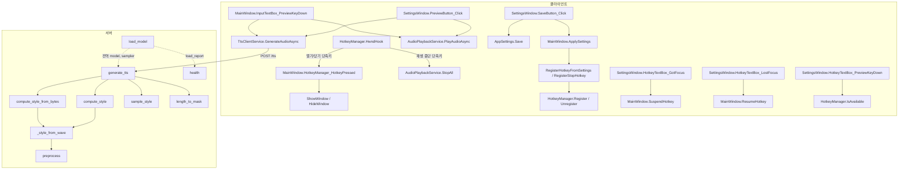

# TTS Overlay API, 함수별 동작 레퍼런스

> 기준일: 2026-10-10
> 전체 구조와 사용법은 [README](../README.md), 개발 중 겪은 문제는 [history.md](./history.md)를 참고할 것.

---

## 목차

1. [HTTP API](#1-http-api)
   - [POST /tts](#11-post-tts)
   - [GET /health](#12-get-health)
2. [서버: server.py](#2-서버-serverpy)
3. [서버: download_model.py](#3-서버-download_modelpy)
4. [서버: list_repo.py](#4-서버-list_repopy)
5. [클라이언트: TtsClientService](#5-클라이언트-ttsclientservice)
6. [클라이언트: AudioPlaybackService](#6-클라이언트-audioplaybackservice)
7. [클라이언트: HotkeyManager](#7-클라이언트-hotkeymanager)
8. [클라이언트: AppSettings](#8-클라이언트-appsettings)
9. [클라이언트: MainWindow](#9-클라이언트-mainwindow)
10. [클라이언트: SettingsWindow](#10-클라이언트-settingswindow)
11. [호출 관계 요약](#11-호출-관계-요약)

---

## 1. HTTP API

서버 기본 주소는 `http://127.0.0.1:10000`이다. 기본 compose 설정은 이 PC에서만 접속되도록 포트를 묶어 둔다. 인증은 없다.

### 1.1 `POST /tts`

텍스트와 참조 음성을 받아 합성한 WAV를 돌려준다. 구현: [server.py:295-415](../TTS_Server/server.py#L295-L415)

**요청 본문 (`application/json`)**

| 필드 | 타입 | 기본값 | 서버 측 검증 | 설명 |
|---|---|---|---|---|
| `text` | string | (필수) | 빈 문자열이면 400, 2,000자 초과면 422 | 합성할 문장 |
| `speaker_wav_b64` | string \| null | `null` | base64 디코딩 실패 시 400, 7천만 자(원본 약 50MB) 초과면 422 | 참조 오디오 파일 전체의 base64. 있으면 `speaker_id`보다 우선 |
| `speaker_id` | string | LibriTTS 예제 경로 | 경로가 컨테이너에 존재해야 사용됨 | 컨테이너 내부 파일 경로. `"0"`이나 존재하지 않는 경로는 무시 |
| `alpha` | float | `0.1` | 0\~1 | 음색 블렌딩. 0이면 참조 음색만, 1이면 diffusion 예측만 |
| `beta` | float | `0.5` | 0\~1 | 운율 블렌딩. 0이면 참조 운율만, 1이면 diffusion 예측만 |
| `diffusion_steps` | int | `10` | 1\~100 | 확산 샘플링 단계 수 |
| `embedding_scale` | float | `1.0` | 0\~10 | 텍스트 조건 강도 (classifier-free guidance 배율) |
| `speed` | float | `1.0` | 0.1\~4.0 | 예측 길이를 이 값으로 나눔. 1보다 크면 빨라짐 |
| `ref_start` | float \| null | `null` | 아래 표 참조 | 참조 구간 시작(초). `speaker_wav_b64`일 때만 적용 |
| `ref_end` | float \| null | `null` | 아래 표 참조 | 참조 구간 끝(초). `speaker_wav_b64`일 때만 적용 |

범위를 벗어난 값은 FastAPI가 422로 거부한다. 클라이언트 슬라이더 범위(alpha, beta 0\~1, steps 3\~30, speed 0.5\~2.0)는 이보다 좁으며 UI에서만 강제된다.

**참조 음성 선택 순서**

1. `speaker_wav_b64`가 있으면 디코딩해서 사용
2. 없으면 `speaker_id`가 비어 있지 않고 `"0"`이 아니며 컨테이너에 존재하는 경로일 때 그 파일 사용
3. 둘 다 아니면 400

**참조 오디오 길이 규칙** (`speaker_wav_b64` 경로에만 적용)

| 조건 | 결과 |
|---|---|
| 전체 길이 3초 미만 | 400 |
| 구간 미지정, 15초 이하 | 전체 사용 |
| 구간 미지정, 15초 초과 | 앞 15초 사용 |
| 구간 지정, `start < 0` 또는 `end > 길이 + 0.05` 또는 `start >= end` | 400 |
| 구간 지정, 구간 길이 3초 미만 | 400 |
| 구간 지정, 구간 길이 15초 초과 | `start`부터 15초로 자름 |
| `ref_start`만 지정 | 끝은 파일 끝 |
| `ref_end`만 지정 | 시작은 0 |

**응답**

| 상태 | 본문 | 발생 조건 |
|---|---|---|
| 200 | `audio/wav`, 24,000Hz, 16bit, mono, 피크 정규화됨 | 정상 |
| 400 | `{"detail": "Text is empty"}` | `text`가 빈 문자열 |
| 400 | `{"detail": "speaker_wav_b64 is not valid base64"}` | base64 오류 |
| 400 | `{"detail": "오디오 포맷을 인식할 수 없습니다. ..."}` | 디코딩 실패 |
| 400 | `{"detail": "참조 오디오가 너무 짧습니다. ..."}` | 3초 미만 |
| 400 | `{"detail": "참조 구간이 올바르지 않습니다. ..."}` | 구간 범위 오류 |
| 400 | `{"detail": "선택 구간이 너무 짧습니다. ..."}` | 구간 3초 미만 |
| 400 | `{"detail": "No reference voice provided. ..."}` | 참조 음성 없음 |
| 422 | FastAPI 검증 오류 (`detail`이 배열) | 필드 타입 불일치, `text` 누락, 범위, 길이 초과 |
| 500 | `{"detail": "Model is not loaded"}` | 모델 로딩 실패 상태 |
| 500 | `{"detail": "<예외 메시지>"}` | 추론 중 예외 |

**호출 예**

```bash
curl -X POST http://127.0.0.1:10000/tts -H "Content-Type: application/json" -d "{\"text\":\"안녕하세요\",\"speaker_wav_b64\":\"$(base64 -w0 ref.wav)\"}" -o out.wav
```

**처리 단계**

| 순서 | 줄 | 동작 |
|---|---|---|
| 1 | 300-303 | 빈 텍스트, 모델 미로딩 검사 |
| 2 | 309-324 | 참조 스타일 `ref_s` (1×256) 결정 |
| 3 | 330-331 | `_g2p(text)` -> `h2j()` 자모 분해 |
| 4 | 332-339 | 사전에 있는 문자만 토큰화, 앞뒤에 0 추가, 텐서 (1×T) |
| 5 | 342-347 | 길이 마스크, `text_encoder` -> `t_en`, `prosodic_text_encoder` -> `d_en` |
| 6 | 352 | `sample_style()`로 diffusion 샘플링 -> `s_pred` (1×256). 발산 검사 포함 |
| 7 | 354-360 | 앞 128(음색)은 alpha로, 뒤 128(운율)은 beta로 참조와 블렌딩 |
| 8 | 362-369 | 운율 예측기로 토큰별 길이 예측, `speed`로 나누고 최소 1프레임 |
| 9 | 371-375 | 토큰×프레임 정렬 행렬 생성 |
| 10 | 377-385 | 운율 특징을 프레임으로 펼친 뒤 한 프레임 시프트 |
| 11 | 387 | F0와 에너지 예측 |
| 12 | 389-393 | 텍스트 특징을 프레임으로 펼친 뒤 한 프레임 시프트 |
| 13 | 395-396 | 디코더로 파형 생성, 끝 50샘플 제거 |
| 14 | 399-409 | 피크 정규화, int16 변환, 메모리 WAV로 응답 |

### 1.2 `GET /health`

모델 로딩 결과를 돌려준다. 구현: [server.py:280-293](../TTS_Server/server.py#L280-L293)

| 필드 | 타입 | 의미 |
|---|---|---|
| `model_loaded` | bool | 전역 `model`이 만들어졌는지. 가중치 로드 도중 실패해도 `true`일 수 있으므로 아래 필드와 함께 봐야 함 |
| `device` | string | `"cuda"` 또는 `"cpu"` |
| `g2p` | bool | g2pk 초기화 성공 여부. `false`면 자모 분해만 사용 중 |
| `all_core_modules_loaded` | bool | 핵심 7개 모듈이 모두 로드됐는지 |
| `missing_core_modules` | string[] | 로드되지 않은 핵심 모듈 |
| `loaded` | string[] | 키 이름이 그대로 맞아 로드된 모듈 |
| `remapped` | string[] | 위치 기반 재매핑으로 로드된 모듈 |
| `missing` | string[] | 체크포인트에 없던 모듈 |
| `error` | string \| null | 로딩 중 예외 메시지 |

핵심 7개 모듈: `decoder`, `predictor`, `text_encoder`, `prosodic_text_encoder`, `style_encoder`, `predictor_encoder`, `diffusion`

정상 판정 기준은 `all_core_modules_loaded: true`, `error: null`, `device: "cuda"`이다.

---

## 2. 서버: server.py

### 전역 상태

| 이름 | 초기값 | 용도 |
|---|---|---|
| `model` | `None` | 모듈 묶음. `load_model()`이 채움 |
| `config` | `None` | YAML 설정 |
| `sampler` | `None` | `DiffusionSampler` |
| `load_report` | 빈 목록들 | `/health`에 노출되는 로딩 결과 |
| `device` | `cuda` / `cpu` | 추론 장치 |
| `word_index_dictionary` | `symbols` 기반 | 문자 -> 토큰 인덱스 |
| `_g2p` | `G2p()` 또는 `None` | 한국어 발음 변환기 |
| `to_mel` | `MelSpectrogram` | 80채널, n_fft 2048, win 1200, hop 300 |
| `mean`, `std` | `-4`, `4` | 로그 멜 정규화 상수 |
| `_style_cache` | `{}` | 캐시 키 -> 스타일 텐서 |
| `SR` | `24000` | 샘플레이트 |
| `MAX_TEXT_CHARS` | `2000` | `text` 길이 상한 |
| `MAX_REF_B64_CHARS` | `70_000_000` | `speaker_wav_b64` 길이 상한 |
| `MIN_REF_SEC`, `MAX_REF_SEC` | `3.0`, `15.0` | 참조 길이 하한, 상한 |

### `class TTSRequest(BaseModel)` — [28-51](../TTS_Server/server.py#L28-L51)

`/tts` 요청 스키마다. 필드는 [1.1](#11-post-tts)과 같다.

### `preprocess(wave)` — [83-87](../TTS_Server/server.py#L83-L87)

| | |
|---|---|
| 입력 | `wave`: 1차원 numpy 배열 (24kHz) |
| 출력 | 정규화된 로그 멜 텐서, shape `(1, 80, 프레임)` |
| 동작 | `to_mel` -> `log(1e-5 + mel)` -> `(x - mean) / std` |

### `_style_from_wave(wave)` — [96-102](../TTS_Server/server.py#L96-L102)

| | |
|---|---|
| 입력 | `wave`: 1차원 numpy 배열 |
| 출력 | 스타일 텐서 `(1, 256)`. 앞 128이 `style_encoder`(음색), 뒤 128이 `predictor_encoder`(운율) |
| 동작 | `librosa.effects.trim(top_db=30)`으로 앞뒤 무음 제거 -> `preprocess` -> 두 인코더를 `no_grad`로 통과 -> 이어 붙임 |
| 전제 | `model`이 로드되어 있어야 함 |

### `compute_style(path)` — [104-106](../TTS_Server/server.py#L104-L106)

| | |
|---|---|
| 입력 | 컨테이너 내부 파일 경로 |
| 출력 | 스타일 텐서 `(1, 256)` |
| 동작 | `librosa.load(path, sr=24000)` -> `_style_from_wave` |
| 비고 | 길이 검증과 캐시가 없음. `speaker_id` 경로 방식에서만 호출 |

### `compute_style_from_bytes(raw, ref_start=None, ref_end=None)` — [108-165](../TTS_Server/server.py#L108-L165)

| | |
|---|---|
| 입력 | `raw`: 오디오 파일 바이트, `ref_start`/`ref_end`: 사용할 구간(초) |
| 출력 | 스타일 텐서 `(1, 256)` |
| 예외 | `HTTPException(400)`: 포맷 인식 실패, 길이 부족, 구간 오류 |
| 부수효과 | 임시 파일 생성 후 삭제, `_style_cache` 갱신 |

동작 순서:

1. 캐시 키 `sha1(raw) : ref_start : ref_end`로 조회. 있으면 바로 반환(디코딩도 생략)
2. `.audio` 확장자의 임시 파일에 쓰고 `librosa.load`로 읽음. 실패하면 400. `finally`에서 임시 파일 삭제
3. 전체 길이가 3초 미만이면 400
4. 구간이 지정됐으면 검증 후 잘라내고(최대 15초), 지정되지 않았는데 15초를 넘으면 앞 15초만 사용
5. `_style_from_wave` 호출, 결과를 캐시에 저장

### `sample_style(embedding, ref_s, embedding_scale, num_steps)` — [177-201](../TTS_Server/server.py#L177-L201)

| | |
|---|---|
| 입력 | 운율 텍스트 임베딩, 참조 스타일 `(1, 256)`, 표현력 강도, 확산 단계 수 |
| 출력 | 스타일 텐서 `(1, 256)` |

diffusion으로 스타일을 뽑고, 결과가 발산했는지 검사한다.

1. 요청된 `embedding_scale`로 샘플링. `_style_is_sane`을 통과하면 반환
2. 실패하면 최대 3회까지 다시 샘플링
3. 계속 실패하고 `embedding_scale`이 1.0이 아니면 1.0으로 샘플링
4. 그래도 실패하면 참조 스타일을 그대로 반환

`_style_is_sane(s_pred, ref_s)`는 값이 유한하고 `|s_pred - ref_s|`가 `ref_s` 노름의 2배(`STYLE_DIVERGENCE_LIMIT`) 이하일 때 참이다.

**배경 (실측)**: `embedding_scale`이 1.0이 아니면 sampler가 classifier-free guidance 경로를 선택하는데, 이 체크포인트에서는 그 경로가 무작위로 발산한다. 발산한 스타일이 쓰이면 길이 예측이 폭주해 7\~29초짜리 잡음이 나온다. 정상 샘플의 `|s_pred - ref_s|`는 1.8\~2.7, 발산 샘플은 20\~수백만이었다.

| `embedding_scale` | 수정 전 잡음 비율 | 수정 후 |
|---|---|---|
| 1.0 | 0/240 | 0/100 |
| 1.1 | 22/60 | 0/100 |
| 1.5 | 38/50 | 0/100 |
| 3.0 | 45/50 | 0/100 |

1.5 이상에서는 거의 매번 1.0으로 대체되므로, 이 체크포인트에서 1.0보다 큰 값은 실질적인 효과가 없다.

### `length_to_mask(lengths)` — [203-206](../TTS_Server/server.py#L203-L206)

| | |
|---|---|
| 입력 | `lengths`: 길이 텐서 `(B,)` |
| 출력 | bool 마스크 `(B, 최대길이)`. 패딩 위치가 `True` |
| 비고 | 배치 크기가 항상 1이라 실제로는 전부 `False` |

### `load_model()` — [208-278](../TTS_Server/server.py#L208-L278)

FastAPI `startup` 이벤트에서 한 번 실행된다.

| | |
|---|---|
| 입력 | 없음. `./models/Korean/Vocos/AIHUB_ML/` 아래의 설정 파일과 체크포인트를 읽음 |
| 출력 | 없음. 전역 `model`, `config`, `sampler`, `load_report`를 채움 |
| 실패 시 | 파일이 없으면 경고 후 반환. 그 외 예외는 `load_report["error"]`에 기록하고 스택을 출력. 서버는 계속 기동됨 |

동작 순서:

1. 파일 존재 확인
2. YAML 로드 -> `model_params` -> `build_model_no_bert(model_params, None, None)`
3. `torch.load(map_location='cpu')` -> `net` 키가 있으면 그 아래를 사용
4. 모듈별 로드
   - 모듈이 `None`이면 건너뜀
   - 체크포인트에 키가 없으면 `missing`에 추가
   - `strict=True` 성공 -> `loaded`
   - 실패 -> 모델 키 순서와 체크포인트 값 순서를 짝지어 새 state_dict 구성 -> `strict=True` 재시도 -> `remapped`
5. 모든 모듈 `eval()` 및 장치 이동
6. `DiffusionSampler` 생성 (ADPM2, Karras σ_min 0.0001, σ_max 3.0, ρ 9.0, clamp 없음)

### `health()` — [280-293](../TTS_Server/server.py#L280-L293)

[1.2](#12-get-health) 참조.

### `generate_tts(request)` — [295-415](../TTS_Server/server.py#L295-L415)

[1.1](#11-post-tts) 참조. `HTTPException`은 그대로 다시 던지고, 그 외 예외는 로그 출력 후 500으로 바꾼다.

---

## 3. 서버: download_model.py

컨테이너 기동 시 `uvicorn`보다 먼저 실행된다.

### 상수

| 이름 | 값 |
|---|---|
| `MODEL_ID` | `5Hyeons/StyleTTS2` |
| `LOCAL_DIR` | `./models/Korean` |
| `TARGET_DIR` | `./models/Korean/Vocos/AIHUB_ML` |
| `CKPT` | `.../epoch_2nd_00006.pth` |
| `CONFIG` | `.../config_aihub_multi_lingual_en_jp_ko_zh_vocos.yml` |
| `MIN_CKPT_BYTES` | `1,000,000,000` |

### `already_downloaded()` — [15-22](../TTS_Server/download_model.py#L15-L22)

| | |
|---|---|
| 출력 | `bool` |
| 동작 | 체크포인트와 설정 파일이 모두 있고 체크포인트가 1GB 이상이면 `True`. 크기가 모자라면 잘린 파일로 보고 메시지 출력 후 `False` |

### `download()` — [25-44](../TTS_Server/download_model.py#L25-L44)

| | |
|---|---|
| 동작 | `already_downloaded()`가 참이면 건너뜀. 아니면 `snapshot_download`로 `Vocos/AIHUB_ML/*.yml`과 `Vocos/AIHUB_ML/epoch_2nd_*.pth`를 `./models/Korean`에 받음 |
| 실패 시 | 예외가 그대로 전파되어 프로세스가 비정상 종료. compose 명령이 `&&`로 이어져 있어 서버가 뜨지 않음 |

HF 캐시에 의존하지 않고 파일을 직접 확인하는 이유는, 캐시가 컨테이너 내부에 있어 컨테이너를 재생성하면 사라지기 때문이다.

---

## 4. 서버: list_repo.py

HF API(`/api/models/5Hyeons/StyleTTS2`)를 호출해 저장소의 파일 이름을 출력하는 8줄짜리 개발 보조 스크립트다. 서버 동작과는 무관하며, `requests`는 `requirements.txt`에 직접 명시되어 있지 않다(다른 패키지의 의존성으로 설치됨).

---

## 5. 클라이언트: TtsClientService

파일: [Services/TtsClientService.cs](../TTS_Overlay/Services/TtsClientService.cs)

인스턴스마다 `HttpClient` 하나를 보유한다. `MainWindow`와 `SettingsWindow`가 각각 인스턴스를 만든다.

### `GenerateAudioAsync(...)`

```csharp
Task<Stream> GenerateAudioAsync(string apiUrl, string text, string speakerId = "0",
    double alpha = 0.1, double beta = 0.5, int diffusionSteps = 10,
    double speed = 1.0, double? refStart = null, double? refEnd = null)
```

| | |
|---|---|
| 입력 | 서버 주소, 합성할 텍스트, 목소리 파일의 전체 경로, 튜닝 값, 참조 구간 |
| 출력 | WAV 바이트를 담은 `MemoryStream`. `apiUrl`이나 `text`가 비어 있으면 `null` |
| 예외 | 목소리 파일이 없으면 안내 문구를 담은 `Exception`. 서버가 2xx가 아닌 응답을 주면 서버 메시지를 담은 `Exception`. 연결 실패는 `HttpRequestException`, 100초 초과는 `TaskCanceledException` |

동작 순서:

1. `apiUrl` 또는 `text`가 공백이면 `null` 반환
2. `speakerId`가 비어 있거나 그 경로에 파일이 없으면 "목소리 오디오 파일을 찾을 수 없습니다"로 시작하는 안내를 예외로 던진다. 서버로 요청을 보내지 않는다
3. 파일 전체를 읽어 base64로 변환
4. 페이로드를 만들어 JSON으로 직렬화. `embedding_scale`은 항상 `1.0`을 넣는다. `speaker_id`에는 경로 문자열이 그대로 들어가지만, 서버는 `speaker_wav_b64`가 있으면 그 값을 사용하지 않는다
5. `PostAsync`
6. 실패 응답이면 본문의 `detail`을 꺼내 예외로 던진다. 값 범위 오류(422)처럼 `detail`이 배열이면 `필드 이름: 메시지` 형태로 줄을 나눠 합친다
7. 성공이면 본문을 바이트 배열로 읽어 `MemoryStream`으로 반환

---

## 6. 클라이언트: AudioPlaybackService

파일: [Services/AudioPlaybackService.cs](../TTS_Overlay/Services/AudioPlaybackService.cs)

### `GetOutputDevices()`

| | |
|---|---|
| 출력 | `List<string>`: 장치 이름 목록 |
| 동작 | 인덱스 `-1`(Microsoft 사운드 매퍼, 즉 시스템 기본 장치)부터 `DeviceCount - 1`까지 `ProductName`을 수집 |
| 비고 | WinMM API 특성상 이름이 31자에서 잘림 (예: `CABLE Input(VB-Audio Virtual Ca`) |

### `PlayAudioAsync(audioStream, targetDeviceName, volume = 1.0f, monitor = false, monitorDeviceName = "")`

| | |
|---|---|
| 입력 | WAV 스트림, 송출 장치 이름(부분 일치), 볼륨 0\~1, 송출시 듣기 여부, 듣기 장치 이름 |
| 출력 | 모든 장치의 재생이 끝나면 완료되는 `Task` |

동작 순서:

1. `FindDevice(targetDeviceName)`으로 송출 장치 번호 결정
2. 스트림을 바이트 배열로 복사 (두 장치가 각자 읽을 수 있게)
3. 송출 장치로 `PlayOnDeviceAsync` 시작
4. `monitor`가 참이면 `FindDevice(monitorDeviceName)`으로 듣기 장치를 정하고, `IsSameDevice`가 거짓일 때만 그 장치로도 `PlayOnDeviceAsync` 시작
5. `Task.WhenAll`로 모두 끝날 때까지 대기

### `static StopAll()`

재생 중인 소리를 모두 즉시 중단한다. 송출, 듣기, 미리듣기가 전부 대상이다. 재생 요청마다 취소 토큰을 static 목록에 등록해 두고, 호출되면 전부 취소한다. 각 재생 루프는 30ms 간격으로 취소 여부를 확인해 `waveOut.Stop()`을 호출한다. 실측 중단 지연은 약 60ms였다.

### 보조 메서드 (private)

| 메서드 | 동작 |
|---|---|
| `FindDevice(deviceName)` | 이름이 비어 있으면 `-1`(시스템 기본 장치). 아니면 0번부터 순회해 `ProductName.Contains(deviceName)`인 첫 장치 번호, 없으면 `-1` |
| `IsSameDevice(a, b)` | 번호가 같으면 참. 한쪽이 `-1`이면 다른 쪽이 Windows 기본 장치인지 `IsDefaultDevice`로 확인. 소리가 두 번 겹치는 것을 막는 용도 |
| `PlayOnDeviceAsync(wavBytes, deviceNumber, volume)` | 장치 하나에 대한 실제 재생. `VolumeSampleProvider`로 볼륨을 0\~1로 제한해 샘플 값에 곱하고, 재생이 끝날 때까지 100ms 간격으로 대기 |
| `IsDefaultDevice(deviceNumber)` | 기본 재생 장치의 전체 이름이 WaveOut의 `ProductName`(31자에서 잘림)으로 시작하면 같은 장치로 판정. 확인에 실패하면 `false` |

**실행 검증 (2026-10-08)**: 들리지 않는 크기(-60dB)의 신호를 재생하면서 각 장치의 출력 레벨을 측정했다.

| 경우 | 신호가 잡힌 장치 |
|---|---|
| 송출만 (듣기 꺼짐) | CABLE Input |
| 송출 + 듣기 (기본 장치) | CABLE Input, 기본 장치 |
| 송출 + 듣기 (장치 이름 지정) | CABLE Input, 지정한 장치 |
| 송출 장치와 듣기 장치가 같음 | 해당 장치 한 곳, 겹침 없음 |
| 미리듣기 방식 (송출 장치 이름 없음) | 기본 장치만 |


---

## 7. 클라이언트: HotkeyManager

파일: [Services/HotkeyManager.cs](../TTS_Overlay/Services/HotkeyManager.cs). `IDisposable` 구현.

인스턴스 하나가 전역 단축키 하나를 맡는다. `MainWindow`는 두 개를 만든다. 하나는 입력창 열기/닫기, 다른 하나는 재생 중단이다. 같은 창 핸들에 등록하지만 ID가 달라서 서로 간섭하지 않는다.

### 상수

| 이름 | 값 | 의미 |
|---|---|---|
| `HOTKEY_ID` | `9000` | 입력창 열기/닫기 단축키 ID. 생성자의 기본값 |
| `STOP_HOTKEY_ID` | `9002` | 재생 중단 단축키 ID |
| `MOD_ALT` / `MOD_CONTROL` / `MOD_SHIFT` / `MOD_WIN` | `1` / `2` / `4` / `8` | Win32 수정자 플래그 |
| `DEFAULT_MODIFIERS` / `DEFAULT_KEY` | `MOD_CONTROL` / `0x54` | 기본 조합 Ctrl + T |
| `MOD_NOREPEAT` (private) | `0x4000` | 키를 누르고 있어도 반복 발생하지 않게 하는 플래그. `Register`가 항상 덧붙인다 |
| `PROBE_HOTKEY_ID` (private) | `9001` | `IsAvailable`이 시험 등록할 때만 잠깐 사용하는 ID |

### 생성자와 이벤트

- `HotkeyManager(int id = HOTKEY_ID)`: 이 인스턴스가 관리할 단축키 ID를 받는다
- `HotkeyPressed`: `WM_HOTKEY`를 받았고 ID가 일치하면 UI 스레드에서 발생한다

### 메서드

| 메서드 | 동작 |
|---|---|
| `static string Format(uint modifiers, uint key)` | `"Ctrl + Shift + T"` 형태의 문자열을 만든다. 순서는 Ctrl, Alt, Shift, Win. 가상 키를 WPF `Key`로 바꿀 수 없으면 16진수로 표시한다 |
| `static bool IsModifierKey(Key key)` | 좌우 Ctrl/Alt/Shift/Win과 `Key.System`이면 `true` |
| `static uint CurrentModifiers()` | 현재 눌린 수정자를 Win32 플래그로 변환한다. WPF의 `Keyboard.Modifiers`가 Win 키를 알려 주지 않아서, Win 키는 `Keyboard.IsKeyDown`으로 직접 확인한다 |
| `static bool IsAvailable(IntPtr windowHandle, uint modifiers, uint key)` | 조합을 지금 등록할 수 있는지 시험한다. 잠깐 등록해 보고 바로 해제한다. 윈도우나 다른 프로그램이 이미 사용 중이면 `false` |
| `void Setup(IntPtr windowHandle)` | 창 핸들을 저장하고 `HwndSource`에 메시지 훅을 추가한다 |
| `bool Register(uint modifiers, uint key)` | `RegisterHotKey`를 호출한다. 핸들이 없거나 조합이 이미 사용 중이면 `false` |
| `void Unregister()` | `UnregisterHotKey`를 호출한다 |
| `IntPtr HwndHook(...)` (private) | `WM_HOTKEY`(0x0312)이고 ID가 일치하면 `HotkeyPressed`를 발생시킨다 |
| `void Dispose()` | 등록을 해제하고 메시지 훅을 제거한다 |

---

## 8. 클라이언트: AppSettings

파일: [Models/AppSettings.cs](../TTS_Overlay/Models/AppSettings.cs). 저장 위치는 실행 파일 폴더의 `settings.json`.

### 속성

| 속성 | 타입 | 기본값 | 설명 |
|---|---|---|---|
| `TtsApiUrl` | string | `http://127.0.0.1:10000/tts` | `/tts` 전체 URL |
| `OutputDeviceName` | string | `""` | 출력 장치 이름. 비어 있으면 시스템 기본 장치 |
| `UseSpotlightMode` | bool | `false` | 심플 창(한 줄짜리 입력창) 사용 |
| `SpeakerId` | string | `voice\voice.opus` | 목소리 파일 경로. 실행 폴더 안의 파일은 상대 경로, 밖의 파일은 전체 경로로 저장된다 |
| `SpeakerPath` | string | (계산값) | `SpeakerId`를 전체 경로로 바꾼 값. `settings.json`에는 저장되지 않는다. 파일을 열 때는 이 값을 사용한다 |
| `HotkeyModifiers`, `HotkeyKey` | uint | `2`, `0x54` | 입력창 열기/닫기 단축키. 기본 Ctrl + T |
| `StopHotkeyModifiers`, `StopHotkeyKey` | uint | `3`, `0x58` | 재생 중단 단축키. 기본 Ctrl + Alt + X |
| `WindowTop`, `WindowLeft` | double | `NaN` | 저장된 창 위치. `NaN`이면 화면 중앙 |
| `Volume` | float | `1.0` | 재생 볼륨 |
| `MonitorOnSend` | bool | `false` | 송출시 듣기. 출력 장치로 보내는 소리를 듣기 장치로도 동시에 재생 |
| `MonitorDeviceName` | string | `""` | 듣기 장치 이름. 비어 있으면 시스템 기본 장치. 미리듣기도 이 장치로 재생 |
| `Alpha` | double | `0.1` | 서버 `alpha` |
| `Beta` | double | `0.5` | 서버 `beta` |
| `DiffusionSteps` | int | `10` | 서버 `diffusion_steps` |
| `Speed` | double | `1.0` | 서버 `speed` |
| `RefStartSec`, `RefEndSec` | double | `0.0` | 참조 구간. `RefEndSec`가 0 이하면 미지정 |

표현력 강도(`embedding_scale`)는 설정에 없다. 클라이언트가 항상 1.0을 보낸다.

### 정적 멤버

| 멤버 | 동작 |
|---|---|
| `SupportedAudioExtensions` | 등록할 수 있는 확장자. `.wav`, `.flac`, `.ogg`, `.opus`, `.mp3`, `.m4a` |
| `VoiceFolder` | 목소리 파일을 두는 기본 폴더. 실행 폴더의 `voice` |
| `DefaultSpeakerPath` | 기본 목소리 파일. 실행 폴더의 `voice\voice.opus` |
| `ToStoredPath(path)` | 저장용 경로로 바꾼다. 실행 폴더 안이면 상대 경로, 밖이면 전체 경로. 이름이 비슷한 옆 폴더를 실행 폴더 안으로 착각하지 않도록 폴더 구분자까지 포함해서 비교한다 |
| `ResolvePath(stored)` | 저장된 경로를 전체 경로로 바꾼다. 상대 경로는 실행 폴더 기준 |
| `IsSupportedAudioFile(path)` | 확장자가 지원 목록에 있으면 `true`. 대소문자를 구분하지 않는다 |

### 메서드

| 메서드 | 동작 |
|---|---|
| `static AppSettings Load()` | 파일이 있으면 읽어서 반환한다. `SpeakerId`가 비어 있거나 예전 기본값 `"0"`이면 기본 경로로 바꾸고, 실행 폴더 안의 전체 경로는 상대 경로로 정리한다. 파일이 없거나 오류가 나면 기본값 객체를 반환한다 |
| `void Save()` | 들여쓰기한 JSON으로 저장한다. 예외는 무시한다 |

---

## 9. 클라이언트: MainWindow

파일: [MainWindow.xaml.cs](../TTS_Overlay/MainWindow.xaml.cs), [MainWindow.xaml](../TTS_Overlay/MainWindow.xaml)

### 필드

| 필드 | 용도 |
|---|---|
| `_settings` | 현재 설정 |
| `_hotkeyManager` | 입력창 열기/닫기 단축키 |
| `_stopHotkeyManager` | 재생 중단 단축키 |
| `_audioService`, `_ttsClient` | 서비스 인스턴스 |
| `_isProcessing` | 합성과 재생이 진행 중인지. 중복 요청을 막는다 |
| `_activeModifiers`, `_activeKey`, `_hasActiveHotkey` | 마지막으로 등록에 성공한 열기/닫기 단축키. 되돌릴 때 사용한다 |

### 화면 구성

- 일반 창: 윗줄에 위치 저장, 설정, 종료 버튼이 있고 아래에 입력칸과 상태 문구가 있다
- 심플 창: 윗줄과 상태 문구를 숨기고 높이 80의 한 줄 입력창이 된다. 입력칸 오른쪽에 설정 버튼(`SimpleSettingsButton`)이 표시된다
- 우클릭 메뉴(`OverlayMenu`): 설정, 심플 창/일반 창 전환, 현재 위치 저장, 종료. 창 테두리와 입력칸 어디에서 우클릭해도 같은 메뉴가 나온다

### 메서드

| 메서드 | 발생 시점 | 동작 |
|---|---|---|
| `MainWindow()` | 앱 시작 | 서비스를 만들고, 입력칸의 우클릭 메뉴를 `OverlayMenu`로 바꾸고, `Loaded`/`Closed` 핸들러를 연결한다 |
| `MainWindow_Loaded` | 창 로드 | 설정을 읽고 `ApplySettings` 호출, 저장된 위치 복원, 단축키 관리자 2개를 준비하고 각각 등록한다 |
| `RegisterHotkeyFromSettings(showErrors)` | 로드 시, 설정 저장 시 | 아래 설명 |
| `RegisterStopHotkey(showErrors)` | 로드 시, 설정 저장 시, 일시 해제 후 | 재생 중단 단축키를 해제한 뒤 설정 값으로 다시 등록한다. 실패하고 `showErrors`가 참이면 안내를 표시한다 |
| `SuspendHotkey()` | 설정 창의 단축키 칸을 클릭했을 때 | 두 단축키를 모두 해제한다. 등록된 채로 두면 그 조합을 눌러도 입력 칸에 전달되지 않기 때문이다 |
| `ResumeHotkey()` | 단축키 칸을 벗어났을 때, 설정 창을 닫았을 때 | 두 단축키를 다시 등록한다 |
| `ApplySettings(settings)` | 로드 시, 설정 저장 시, 창 전환 시 | 설정을 교체하고 두 단축키를 다시 등록한다. 우클릭 메뉴의 전환 항목 이름을 바꾸고, 심플 창 여부에 따라 창 크기, 여백, 글꼴, 줄바꿈 허용, 설정 버튼 표시를 바꾼다 |
| `HotkeyManager_HotkeyPressed` | 열기/닫기 단축키 | 창이 보이면 숨기고, 숨겨져 있으면 표시한다 |
| `ShowWindow()` | | `Show` -> `Activate` -> 입력칸 포커스와 전체 선택 |
| `HideWindow()` | | `Hide` 후 입력칸을 비운다 |
| `InputTextBox_PreviewKeyDown` | 입력칸 키 입력 | 아래 설명 |
| `ToggleModeMenuItem_Click` | 우클릭 메뉴의 전환 항목 | 심플 창 설정을 반대로 바꾸고 저장한 뒤 `ApplySettings`를 호출한다 |
| `SaveLocationButton_Click` | 위치 저장 버튼, 메뉴 | 현재 창 위치를 설정에 저장하고 알림을 표시한다 |
| `SettingsButton_Click` | 설정 버튼, 메뉴 | `SettingsWindow`를 모달로 표시한다 |
| `CloseButton_Click` | X 버튼, 메뉴의 종료 | 현재 등록된 단축키를 안내 문구에 넣어 확인한 뒤 `Application.Current.Shutdown()` |
| `MainBorder_MouseLeftButtonDown` | 테두리 드래그 | `DragMove()`로 창을 옮긴다 |
| `MainWindow_Closed` | 창 닫힘 | 두 단축키 관리자를 해제한다 |

재생 중단 단축키가 눌리면 `AudioPlaybackService.StopAll()`이 호출된다. 별도의 메서드 없이 `MainWindow_Loaded`에서 이벤트에 직접 연결되어 있다.

**`RegisterHotkeyFromSettings` 상세**

1. `_hotkeyManager`가 아직 없으면 `false` 반환 (로드 초기의 `ApplySettings` 호출이 여기에 해당)
2. 기존 등록 해제
3. 설정의 조합으로 등록. 성공하면 그 조합을 "활성 조합"으로 기억하고 `true` 반환
4. 실패하면 직전 활성 조합으로 다시 등록을 시도한다. 성공하면 설정 값을 그 조합으로 되돌리고 저장한다
5. `showErrors`가 참이면 실패 사유와 되돌렸는지 여부를 메시지 상자로 표시한다
6. `false` 반환

**`InputTextBox_PreviewKeyDown` 상세**

| 입력 | 동작 |
|---|---|
| `Esc` | 창을 숨긴다 |
| `Shift+Enter` (일반 창) | 줄바꿈 |
| `Enter`, 입력이 공백뿐 | 무시 |
| `Enter`, 이미 처리 중 | 무시. 창과 텍스트는 그대로 유지된다 |
| `Enter` | 텍스트 확보 -> 창을 즉시 숨김 -> `GenerateAudioAsync` -> `PlayAudioAsync` -> 처리 중 표시 해제 |

참조 구간은 `RefEndSec > 0`일 때만 전송하고, 아니면 둘 다 `null`로 보낸다. 목소리 파일 경로는 `SpeakerPath`(전체 경로)를 넘긴다. 재생할 때는 출력 장치, 볼륨, 송출시 듣기 여부, 듣기 장치를 함께 넘긴다. 합성이나 재생에서 예외가 나면 메시지를 경고 상자로 보여 준다.

---

## 10. 클라이언트: SettingsWindow

파일: [SettingsWindow.xaml.cs](../TTS_Overlay/SettingsWindow.xaml.cs), [SettingsWindow.xaml](../TTS_Overlay/SettingsWindow.xaml)

본문은 스크롤되고, 미리듣기와 저장 버튼은 창 아래에 고정되어 있다.

### 필드

| 필드 | 용도 |
|---|---|
| `_settings` | 생성 시 디스크에서 새로 읽은 설정 |
| `_audioService`, `_ttsClient` | 미리듣기용 서비스 |
| `_isPreviewing` | 미리듣기 중복 실행 방지 |
| `_hotkeyModifiers`, `_hotkeyKey` | 열기/닫기 단축키 칸에 표시 중인 조합 |
| `_stopHotkeyModifiers`, `_stopHotkeyKey` | 재생 중단 단축키 칸에 표시 중인 조합 |

단축키 칸의 값은 저장을 눌러야 적용된다.

### 메서드

| 메서드 | 동작 |
|---|---|
| `SettingsWindow()` | 설정을 읽고 서비스를 만든 뒤 `LoadSettings()`를 호출한다. 창이 닫힐 때 `MainWindow.ResumeHotkey()`가 호출되도록 연결한다 |
| `LoadSettings()` | 설정 값을 화면에 채운다. 목소리 파일은 전체 경로로 표시한다. 장치 목록을 조회해서 출력 장치와 듣기 장치를 선택하고, 슬라이더 값이 바뀌면 라벨이 갱신되도록 연결한다 |
| `PreviewButton_Click` | 아래 설명 |
| `SelectedMonitorDevice()` | 선택된 듣기 장치 이름. 첫 항목(사운드 매퍼, 즉 시스템 기본 장치)이면 빈 문자열 |
| `HotkeyTextBox_GotFocus` | `MainWindow.SuspendHotkey()`를 호출하고 안내 문구 `조합을 누르세요...`를 표시한다 |
| `HotkeyTextBox_LostFocus` | 두 칸의 표시를 현재 조합으로 되돌리고 `MainWindow.ResumeHotkey()`를 호출한다 |
| `HotkeyTextBox_PreviewKeyDown` | 아래 설명. 두 단축키 칸이 이 핸들러를 함께 사용한다 |
| `ResetHotkeyButton_Click` | 열기/닫기 조합을 Ctrl + T로 되돌린다 (저장 전까지 미적용) |
| `ResetStopHotkeyButton_Click` | 재생 중단 조합을 Ctrl + Alt + X로 되돌린다 (저장 전까지 미적용) |
| `GetRefWindow()` | 끝 값이 숫자가 아니거나 0 이하면 `(null, null)`. 아니면 `(시작 또는 0, 끝)` |
| `BrowseSpeakerButton_Click` | 파일 대화상자를 연다. 지원하는 확장자만 보이고 "모든 파일" 항목은 없다. 현재 지정된 파일의 폴더에서 시작하고, 그 폴더가 없으면 `voice` 폴더에서 시작한다. 고른 파일이 `CheckSpeakerFile`을 통과하면 입력칸에 채운다 |
| `CheckSpeakerFile(path)` | 지원하는 확장자인지 확인한다. 아니면 사용할 수 있는 확장자를 안내하고 `false` |
| `SaveButton_Click` | 아래 설명 |

**`PreviewButton_Click` 상세**

1. 이미 미리듣기 중이면 반환
2. 버튼을 비활성화하고 문구를 `재생 중...`으로 바꾼다
3. 입력칸의 목소리 파일 경로를 전체 경로로 바꾸고 `CheckSpeakerFile`로 확인한다. 통과하지 못하면 중단한다
4. 고정 문장 `안녕하세요, 목소리 테스트입니다.`를 **화면에 표시된 현재 값**(저장 전 값 포함)으로 합성 요청한다
5. 결과가 있으면 선택된 **듣기 장치**와 현재 슬라이더 볼륨으로 재생한다. 출력 장치로는 내보내지 않는다. 결과가 `null`이면 URL 확인 안내를 표시한다
6. 예외는 경고 상자로 표시한다
7. 버튼을 `▶ 미리듣기`로 되돌린다

저장하지 않고도 슬라이더를 움직이며 결과를 비교할 수 있다.

**`HotkeyTextBox_PreviewKeyDown` 상세**

1. 키 입력이 다른 곳으로 전달되지 않게 `Handled = true`
2. Alt 조합은 `Key.System`으로 들어오므로 `SystemKey`에서 실제 키를 꺼낸다
3. 수정자 키만 눌린 상태면 대기
4. 수정자가 하나도 없으면 안내 메시지를 표시하고 반환
5. `HotkeyManager.IsAvailable`로 지금 등록할 수 있는 조합인지 시험한다. 윈도우나 다른 프로그램이 사용 중이면 안내하고 반환
6. 다른 칸의 조합과 같으면 안내하고 반환. 두 단축키가 같으면 하나만 등록되기 때문이다
7. 키를 누른 칸에 해당하는 필드에 저장하고 표시를 갱신한다

**`SaveButton_Click`에서 일어나는 일**

1. 목소리 파일 경로를 `CheckSpeakerFile`로 확인한다. 통과하지 못하면 저장하지 않고 설정 창에 머문다
2. 화면의 값을 설정에 반영한다. 목소리 파일 경로는 `AppSettings.ToStoredPath`를 거쳐 저장한다
3. `_settings.Save()` -> `MainWindow.ApplySettings(_settings)` -> 두 단축키 재등록
4. 창을 닫는다

새 열기/닫기 단축키 등록이 실패하면 3번 시점에 이전 조합으로 되돌리고 경고를 표시하며, 되돌린 값이 다시 저장된다.

---

## 11. 호출 관계 요약


